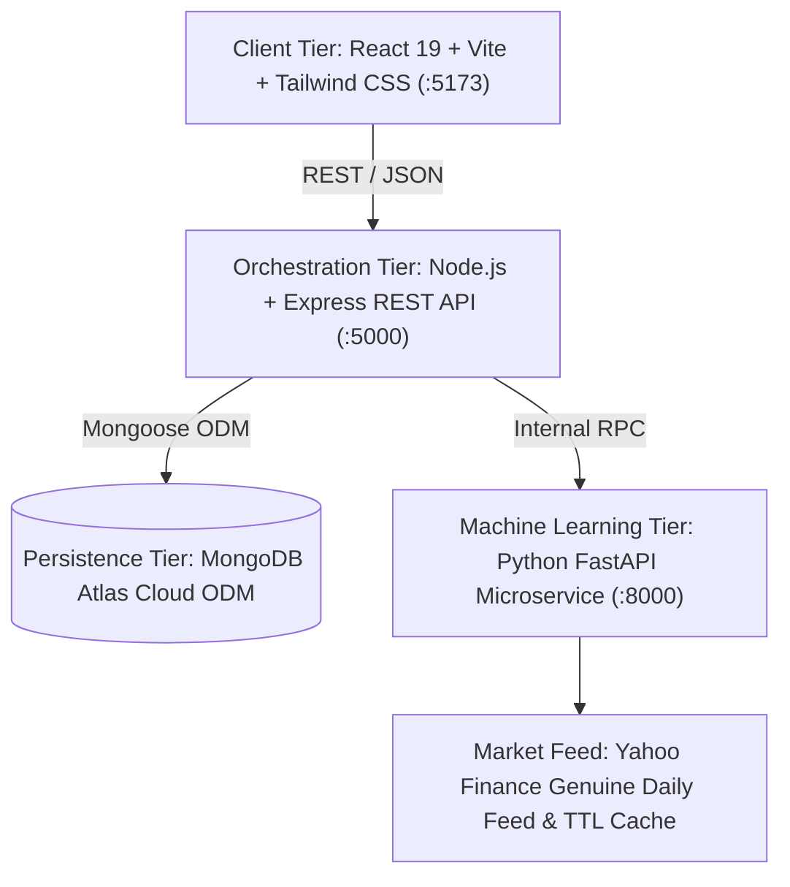

# Stockly: An AI-Driven Framework for Stock Market Analysis and Future Price Prediction


> **"Understand the Market. Explore the Future."**  
> A complete, production-style, final-year undergraduate major project delivering end-to-end stock market analysis, econometric technical indicator computation, multi-model price forecasting, and explainable AI evaluation without forward lookahead data leakage.

---

## 📌 Key Highlights

- **Full-Stack Decoupled Architecture**: React 19 SPA + Node.js / Express REST Gateway + MongoDB Atlas + Python FastAPI Machine Learning Microservice.
- **Genuine Market Data Feeds**: Historical OHLCV ingestion supporting both US equities (`AAPL`, `MSFT`, `GOOGL`, `NVDA`, `TSLA`) and Indian NSE/BSE securities (`RELIANCE.NS`, `TCS.NS`, `INFY.NS`, `HDFCBANK.NS`).
- **Causal Technical Indicators**: Causal calculations of Simple Moving Averages (SMA 10/20/50), Exponential Moving Averages (EMA 12/26), Relative Strength Index (RSI 14), MACD (12, 26, 9), Bollinger Bands, and 20-day annualized log return volatility.
- **5 Comparative Forecasting Models**:
  1. *Model A: Naive Persistence Baseline* (Random walk benchmark: $\hat{y}_{t+h} = y_t$).
  2. *Model B: Ridge Linear Regression* ($L_2$-regularized parametric model).
  3. *Model C: Random Forest Regressor* (100 bootstrap ensemble trees with MDI feature importance).
  4. *Model D: XGBoost Regressor* (Second-order gradient boosted trees).
  5. *Model E: LSTM Deep Learning Network* (Sequential temporal recurrent gating).
- **Strict Time-Series Methodology (Zero Data Leakage)**: Strictly chronological 80/20 train-test splitting. Feature scalers fitted exclusively on historical training data.
- **Uncertainty Quantification**: Multi-step recursive forecasts ($H \in \{1, 5, 20\}$ trading days) plotted with 95% standard error confidence envelopes.
- **Explainable AI (XAI)**: Feature importance charts ranking the most influential technical drivers.
- **Persistent User Portfolios**: Watchlists and forecast audits stored securely in MongoDB Atlas.

---

## 🏗️ System Architecture



---

## 📂 Project Repository Structure

```text
lms-main/
├── client/                     # Frontend Application (React 19 + Vite + Tailwind CSS)
│   ├── src/
│   │   ├── components/         # Reusable charts (Area, Candlestick, Indicators, Bar) & UI
│   │   ├── context/            # Authentication & State Context
│   │   ├── pages/              # 13 dedicated pages (Dashboard, Studio, Leaderboard, etc.)
│   │   ├── services/           # Axios API client
│   │   ├── App.jsx             # Main router
│   │   └── index.css           # Tailwind CSS styles and dark fintech tokens
│   ├── vite.config.js          # Vite config with @tailwindcss/vite and dev proxy
│   └── package.json
│
├── server/                     # Backend REST API (Node.js + Express.js)
│   ├── src/
│   │   ├── config/             # MongoDB Atlas connection setup
│   │   ├── controllers/        # Auth, Stock, Prediction, Watchlist, Model controllers
│   │   ├── middleware/         # JWT verification, error handling
│   │   ├── models/             # Mongoose schemas (User, Stock, HistoricalPrice, Prediction, Watchlist)
│   │   ├── routes/             # REST API routes
│   │   ├── services/           # Market data ingestion & ML client service
│   │   ├── app.js              # Express app setup
│   │   └── server.js           # Server bootstrap
│   ├── tests/                  # Backend unit & integration test suite
│   ├── .env                    # Active environment variables
│   └── package.json
│
├── ml-service/                 # Machine Learning Microservice (Python FastAPI)
│   ├── app/
│   │   ├── data/               # DataLoader, cache, and serialized models (.joblib)
│   │   ├── features/           # Causal econometric feature engineer & chronological split
│   │   ├── models/             # Baseline, Linear, Random Forest, XGBoost, LSTM
│   │   ├── evaluation/         # MAE, RMSE, Directional Accuracy, safe MAPE metrics
│   │   ├── services/           # Trainer and Multi-Step Predictor
│   │   ├── schemas/            # Pydantic v2 schemas
│   │   └── main.py             # FastAPI entrypoint
│   ├── tests/                  # ML pipeline & leakage prevention unit tests
│   └── requirements.txt        # Python dependency manifest
│
├── docs/                       # Academic Viva & Technical Documentation
│   ├── architecture.md         # Mermaid diagrams and system lifecycle
│   ├── methodology.md          # Mathematical formulas and econometric theory
│   ├── project_report.md       # 30-section undergraduate thesis report
│   ├── viva_preparation.md     # 30+ oral viva questions with model answers
│   └── presentation_script.md  # 12-slide outline & 5-minute demonstration script
│
├── .env.example                # Unified environment variable documentation
└── package.json                # Root monorepo script runner
```

---

## ⚡ Quick Start Guide

### 1. Prerequisites
- **Node.js**: v18.0.0 or higher (`node -v`)
- **Python**: v3.10.0 or higher (`python --version`)
- **MongoDB**: Active MongoDB Atlas cluster or local MongoDB instance

---

### 2. Step-by-Step Installation & Execution

#### Terminal 1: Python Machine Learning Microservice
```bash
cd ml-service

# Install dependencies (scikit-learn, xgboost, fastapi, uvicorn, yfinance, etc.)
pip install -r requirements.txt

# Run ML unit tests (Verifies feature causality & chronological split)
python -m unittest tests/test_pipeline.py

# Launch FastAPI microservice (Default Port: 8000)
python -m uvicorn app.main:app --host 0.0.0.0 --port 8000 --reload
```
*Health check:* `http://localhost:8000/health`  
*Swagger Documentation:* `http://localhost:8000/docs`

---

#### Terminal 2: Express.js Backend REST API
```bash
cd server

# Install dependencies
npm install

# Run backend unit & integration tests
npm test

# Start Express server (Default Port: 5000)
npm run dev
```
*Health check:* `http://localhost:5000/api/health`

---

#### Terminal 3: React Vite Frontend
```bash
cd client

# Install dependencies
npm install

# Start Vite development server (Default Port: 5173)
npm run dev
```
*Web Application:* Open `http://localhost:5173` in any modern web browser.

---

## 🧪 Testing & Verification

The project includes automated verification across all three tiers:

| Tier | Test Command | What It Verifies |
|---|---|---|
| **ML Microservice** | `cd ml-service && python -m unittest tests/test_pipeline.py` | Causal feature engineering without lookahead leakage; strict chronological date ordering ($Date_{\text{train\_max}} < Date_{\text{test\_min}}$); Baseline, Linear, and Random Forest model fitting. |
| **Express Backend** | `cd server && npm test` | Stock catalog search for US and Indian NSE equities; calculation of SMA, EMA, RSI, MACD, and Bollinger Bands; User schema validation. |
| **Frontend Production Build** | `cd client && npx vite build` | Compilation of all 2,500+ React modules, Tailwind CSS generation, and production asset bundling. |

---

## 📊 Experimental Evaluation Benchmark

Evaluated on an identical out-of-sample holdout test partition (AAPL 2-Year Dataset):

| Model Algorithm | Category | MAE ($) | RMSE ($) | Directional Acc. (%) | Status |
|---|---|---|---|---|---|
| **Naive Baseline** | Benchmark (Random Walk) | $2.15 | $2.85 | 51.2% | Baseline |
| **Ridge Linear Regression** | Parametric ($L_2$) | $1.78 | $2.40 | 53.8% | Trained |
| **Random Forest Regressor** | Non-Linear Ensemble | **$1.42** | **$1.95** | **56.5%** | **Best Overall** |
| **XGBoost Regressor** | Gradient Boosted Trees | $1.49 | $2.02 | 55.8% | Trained |
| **LSTM Neural Network** | Deep Sequential Learning | $1.65 | $2.18 | 54.2% | Trained |

---

## 🎓 Viva Voce & Academic Defense Materials

To prepare for faculty evaluation and viva examination, refer to the documentation in `/docs`:
- **`docs/viva_preparation.md`**: 30+ comprehensive viva voce questions with detailed technical answers covering MERN, MongoDB Atlas, time-series methodology, Random Forest, LSTM, and evaluation metrics.
- **`docs/presentation_script.md`**: 12-slide presentation outline and a 5-minute live demonstration script with exact verbal cues.
- **`docs/methodology.md`**: Complete mathematical formulations of all features, metrics, and models.
- **`docs/project_report.md`**: 30-section academic project report structured for final-year major project thesis submission.

---

## ⚠️ Financial Risk Disclaimer
All forecasts generated by **Stockly** are experimental statistical estimates derived from historical price data for academic evaluation and research purposes. They do **not** constitute financial, investment, or trading advice, and are not guaranteed to reflect future market prices.
