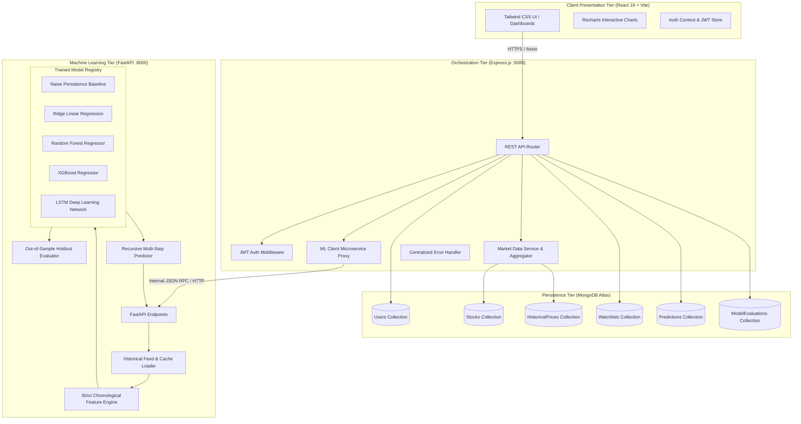
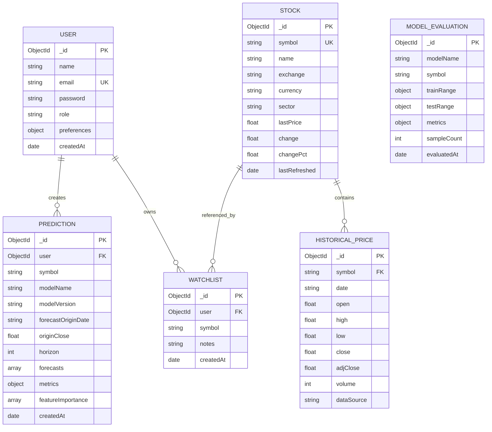
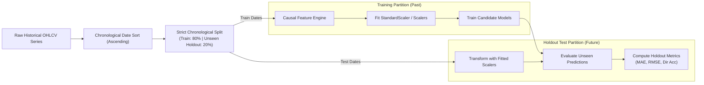

# Stockly: System Architecture & Technical Specifications

**Stockly** is an AI-driven full-stack framework for financial market exploration, causal technical indicator calculation, and multi-step future price forecasting.

---

## 1. High-Level System Architecture

Stockly employs a decoupled service-oriented architecture:
- **Presentation Layer**: React 19 SPA running on Vite with Tailwind CSS and Recharts financial charting.
- **API Gateway & Orchestration Layer**: Node.js & Express REST API managing JWT authentication, MongoDB ODM mapping, caching, rate limiting, and security headers.
- **Machine Learning & Econometric Microservice**: Python FastAPI service performing causal feature engineering, chronological model training, holdout evaluation, and multi-step recursive inference.
- **Persistence Layer**: MongoDB Atlas storing user credentials, stock metadata, cached historical OHLCV bars, watchlists, predictions, and model evaluations.

---

## 2. Request and Response Lifecycle

### A. Prediction Request Flow
1. **User Action**: The client selects stock symbol `AAPL`, model `Random Forest`, and horizon `5 Trading Days` in the AI Prediction Studio.
2. **Gateway Dispatch**: Axios issues `POST /api/predictions` with JWT authentication in the header.
3. **Authentication & Validation**: Express verifies the token (or allows optional guest exploration) and validates horizon ∈ {1, 5, 20}.
4. **ML Proxy Forwarding**: Express dispatches `POST http://localhost:8000/predict` to the Python microservice.
5. **Causal Preprocessing**:
   - Python loads historical bars from cache or Yahoo Finance.
   - Computes causal features (SMA ratios, RSI 14, MACD, Bollinger Bands, Volatility).
6. **Inference & Interval Generation**:
   - Loaded `.joblib` model recursively forecasts $t+1, \dots, t+5$.
   - Computes 95% standard error confidence envelopes ($1.96 \times RMSE \times \sqrt{step}$).
7. **Storage & Response**:
   - Python returns structured JSON containing forecasts, out-of-sample metrics, and feature importances.
   - Express persists the prediction audit to MongoDB Atlas `predictions` collection.
   - Client renders the historical-to-forecast comparison chart and feature contribution bars.

---

## 3. Database Entity-Relationship (ER) Diagram

---

## 4. Time-Series Pipeline & Leakage Prevention

