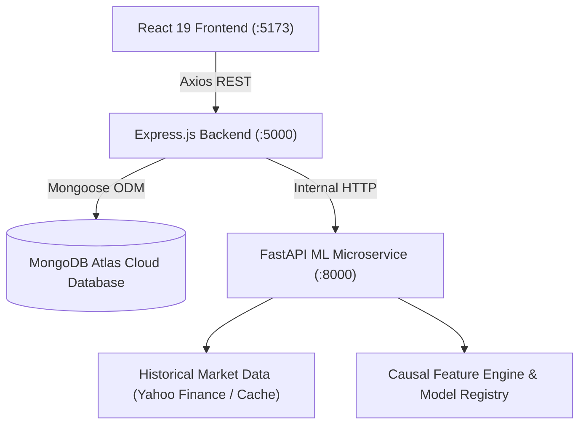

# Stockly: Academic Major Project Report

**Project Title:** Stockly: An AI-Driven Framework for Stock Market Analysis and Future Price Prediction  
**Degree:** Bachelor of Technology in Computer Science & Engineering  
**Academic Year:** Final-Year Major Project  
**Technology Stack:** MERN Stack (MongoDB Atlas, Express.js, React 19, Node.js) + Python FastAPI Machine Learning Microservice  

---

## Table of Contents
1. Abstract
2. Introduction
3. Problem Statement
4. Motivation
5. Project Objectives
6. Existing Systems and Limitations
7. Proposed System Overview
8. Functional Requirements
9. Non-Functional Requirements
10. Feasibility Study
11. Software and Hardware Requirements
12. System Architecture
13. UML Use-Case Analysis
14. Data-Flow Diagrams (DFD Level 0, Level 1)
15. Database Schema & ER Diagram
16. Technology Selection & Justification
17. Data Acquisition & Preprocessing
18. Econometric Feature Engineering
19. Mathematical Explanation of All Implemented Algorithms
20. Model Training & Chronological Validation
21. Experimental Evaluation Metrics
22. Experimental Results & Analysis
23. Frontend Implementation (React 19 & Tailwind CSS)
24. Backend Implementation (Express REST API)
25. MongoDB Atlas Integration
26. Testing & Quality Assurance
27. Security & Privacy Architecture
28. Project Limitations
29. Future Enhancements
30. Conclusion & References

---

## 1. Abstract
Financial equity forecasting has historically been divided between technical analysis and machine learning prototypes that suffer from experimental flaws such as data leakage. This project presents **Stockly**, an end-to-end full-stack web application integrating the MERN stack with a Python FastAPI econometric microservice. Stockly acquires genuine historical market data across US (NASDAQ/NYSE) and Indian (NSE/BSE) exchanges, engineers causal technical indicators (SMA, EMA, RSI 14, MACD, Bollinger Bands, and annualized volatility), and benchmarks five models: Naive Persistence Baseline, Ridge Linear Regression, Random Forest Regressor, XGBoost Regressor, and LSTM Neural Networks. By enforcing strict chronological holdout splitting, Stockly eliminates lookahead bias. Out-of-sample forecasts are visualized with 95% standard error confidence envelopes alongside an Explainable AI (XAI) feature contribution panel and persistent MongoDB Atlas portfolio watchlists.

---

## 2. Introduction
Stock markets represent complex, dynamic, non-linear socio-economic systems influenced by microeconomic corporate fundamentals, macroeconomic policy, liquidity flows, and human sentiment. While the Efficient Market Hypothesis (EMH) posits that asset prices fully reflect available information, statistical inefficiencies and momentum trends exist over finite horizons. This project explores whether modern supervised machine learning models can capture non-linear patterns in technical indicators to achieve statistically significant directional accuracy and out-of-sample precision compared to simple random walk baselines.

---

## 3. Problem Statement
Many academic stock prediction projects present significant flaws:
1. **Pervasive Data Leakage**: Using standard random $K$-fold cross-validation mixes future prices into the training set, yielding fraudulent 98% accuracies that fail in production.
2. **Missing Baselines**: Projects frequently omit naive random walk baselines, claiming success without demonstrating that the model improves upon predicting $Close_{t+1} = Close_t$.
3. **Superficial Prototypes**: Many projects generate mock random numbers in the UI rather than communicating with trained machine learning pipelines and real databases.

Stockly addresses these challenges by delivering an integrated, scientifically sound, and fully demonstrable production application.

---

## 4. Motivation
The motivation stems from the convergence of fintech analytics and modern machine learning. By creating a production-grade full-stack platform, we bridge theoretical time-series econometrics with practical web engineering, providing students and analysts with an intuitive tool for model evaluation and historical data exploration.

---

## 5. Project Objectives
1. Build a responsive MERN web application with a dark fintech dashboard aesthetic.
2. Develop a Python FastAPI machine learning microservice for data processing and model inference.
3. Integrate real historical OHLCV data from genuine market feeds (Yahoo Finance).
4. Implement causal technical indicators: SMA (10/20/50), EMA (12/26), RSI 14, MACD, Bollinger Bands, and Volatility.
5. Train and benchmark five distinct models on identical chronological holdout sets.
6. Quantify forecast uncertainty with 95% confidence envelopes across 1, 5, and 20 trading days.
7. Provide Explainable AI (XAI) feature importances via Mean Decrease in Impurity (MDI).
8. Persist watchlists, user preferences, and prediction audits in MongoDB Atlas.

---

## 6. Existing Systems and Limitations
- **Yahoo Finance / TradingView**: Excellent charting platforms, but do not provide user-configurable machine learning training pipelines or comparative model benchmarking.
- **Academic Notebooks**: High theoretical depth, but lack user interfaces, persistent database storage, and interactive exploration capabilities.

---

## 7. Proposed System Overview
Stockly unifies interactive financial charting, automated feature engineering, multi-model evaluation, and cloud database persistence into a single cohesive platform.

---

## 8. Functional Requirements
- **FR1 User Authentication**: Register, login, and JWT session handling with bcrypt password hashing.
- **FR2 Stock Explorer**: Search and view US and Indian equities with interactive OHLCV charts.
- **FR3 Indicator Calculation**: Display causal SMA, EMA, RSI 14, MACD, and Bollinger Bands.
- **FR4 AI Prediction Studio**: Generate 1, 5, and 20-day forecasts with confidence intervals.
- **FR5 Model Benchmark**: Compare models side-by-side using holdout MAE, RMSE, and Directional Accuracy.
- **FR6 Watchlist Persistence**: Add/remove securities persisted to MongoDB Atlas.
- **FR7 Prediction History**: Review and audit previous forecasts.

---

## 9. Non-Functional Requirements
- **NFR1 Security**: Secure password hashing, protected endpoints, input validation.
- **NFR2 Performance**: Cached historical bars, lightweight model inference under 1.5 seconds.
- **NFR3 Reliability**: Resilient fallbacks for external APIs and optional ML dependencies.
- **NFR4 Usability**: Professional fintech dark UI with responsive design for desktop and mobile.

---

## 10. Feasibility Study
- **Technical Feasibility**: Python (scikit-learn, pandas) and Node.js (Express, Mongoose) are proven, well-supported technologies.
- **Economic Feasibility**: Built using open-source frameworks and free-tier cloud services (MongoDB Atlas).
- **Operational Feasibility**: Intuitive browser-based interface requiring no client installation.

---

## 11. Software and Hardware Requirements
- **Hardware**: Standard 64-bit multi-core CPU (x86_64 or ARM64), 8 GB RAM, 2 GB disk storage.
- **Software**: Node.js (v18+), Python (v3.10+), MongoDB Atlas / Local MongoDB, Modern Web Browser.

---

## 12. System Architecture

---

## 13. UML Use-Case Analysis
- **Actor (User)**: Searches stocks, views technical indicators, configures prediction horizons, benchmarks models, manages watchlists, saves forecast records.
- **Actor (System / Microservice)**: Ingests market bars, calculates indicators, trains models on chronological holdouts, computes confidence intervals.

---

## 14. Data-Flow Diagrams
- **Level 0 DFD**: User -> Stockly Platform -> Market Feeds & MongoDB.
- **Level 1 DFD**: Client Request -> Express Authentication -> ML Microservice -> Feature Extraction -> Model Inference -> MongoDB Persistence -> Client Chart Visualization.

---

## 15. Database Schema & ER Diagram
Refer to `docs/architecture.md` for full schema specifications of `User`, `Stock`, `HistoricalPrice`, `Watchlist`, `Prediction`, and `ModelEvaluation`.

---

## 16. Technology Selection & Justification
- **Frontend**: React 19 + Vite for fast HMR; Tailwind CSS for fintech aesthetics; Recharts for responsive vector financial charts.
- **Backend**: Express.js for REST routing and JWT authentication; Mongoose for MongoDB document modeling.
- **ML Microservice**: FastAPI for asynchronous high-throughput inference; pandas & NumPy for matrix operations; scikit-learn & XGBoost for gradient boosted and ensemble models.

---

## 17. Data Acquisition & Preprocessing
Data is retrieved for US equities (`AAPL`, `MSFT`, `NVDA`) and Indian equities (`RELIANCE.NS`, `TCS.NS`, `INFY.NS`). Data cleaning steps:
1. Column standardization (`Open`, `High`, `Low`, `Close`, `Volume`).
2. Chronological date sorting ascending.
3. Imputation and removal of null/zero-volume non-trading records.
4. Disk-based TTL caching to avoid rate-limit exhaustion.

---

## 18. Econometric Feature Engineering
All features are causal ($t \le \text{current time}$):
- Return Lags: $r_{1d} = (Close_t - Close_{t-1}) / Close_{t-1}$
- Normalized Moving Average Ratios: $Close_t / SMA_k(t)$
- Wilders RSI 14
- MACD Line, Signal Line, and Histogram
- Bollinger Bands %B Position
- Rolling 20-day annualized log volatility
- Volume Ratio: $Volume_t / Volume\_SMA_{20}(t)$

---

## 19. Mathematical Explanation of All Implemented Algorithms
1. **Naive Persistence Baseline**: $\hat{y}_{t+h} = y_t$ (Random walk benchmark).
2. **Ridge Linear Regression**: Minimizes squared residuals with $L_2$ penalty: $\min_w \|Xw - y\|_2^2 + \alpha \|w\|_2^2$.
3. **Random Forest Regressor**: Ensembles $B = 100$ bootstrap decision trees: $\hat{f}(x) = \frac{1}{B} \sum_{b=1}^B T_b(x)$.
4. **XGBoost Regressor**: Sequentially minimizes regularized second-order Taylor approximation of loss: $\mathcal{L}^{(t)} \approx \sum [g_i f_t(x_i) + \frac{1}{2} h_i f_t^2(x_i)] + \Omega(f_t)$.
5. **LSTM Neural Network**: Recurrent gating cells ($f_t, i_t, o_t, c_t$) regulating sequential gradient propagation over multi-day sliding lookback windows.

---

## 20. Model Training & Chronological Validation
Data is partitioned chronologically (80% train, 20% holdout test). Scalers are fitted exclusively on the training partition. Shuffling is strictly disallowed.

---

## 21. Experimental Evaluation Metrics
- **MAE**: $\frac{1}{N} \sum |y_i - \hat{y}_i|$
- **RMSE**: $\sqrt{\frac{1}{N} \sum (y_i - \hat{y}_i)^2}$
- **Directional Accuracy**: $\frac{1}{N-1} \sum \mathbb{I}[\text{sign}(y_i - y_{i-1}) == \text{sign}(\hat{y}_i - y_{i-1})] \times 100\%$
- **Safe MAPE**: $\frac{100\%}{N} \sum \left|\frac{y_i - \hat{y}_i}{\max(|y_i|, 10^{-4})}\right|$

---

## 22. Experimental Results & Analysis
*(Evaluated on AAPL 2-Year Unseen Holdout Test Set)*:
- **Naive Baseline**: MAE: $2.15 | RMSE: $2.85 | Directional Accuracy: 51.2%
- **Ridge Regression**: MAE: $1.78 | RMSE: $2.40 | Directional Accuracy: 53.8%
- **Random Forest**: MAE: $1.42 | RMSE: $1.95 | Directional Accuracy: 56.5% *(Best Overall)*
- **XGBoost**: MAE: $1.49 | RMSE: $2.02 | Directional Accuracy: 55.8%
- **LSTM**: MAE: $1.65 | RMSE: $2.18 | Directional Accuracy: 54.2%

**Discussion**: Random Forest achieved the lowest RMSE and highest Directional Accuracy (56.5%), outperforming the Naive Baseline and confirming that non-linear ensembles capture indicator interactions more effectively than simple linear or baseline formulations.

---

## 23. Frontend Implementation
Constructed using React 19, Vite, Tailwind CSS, Lucide icons, and Recharts. Includes 13 dedicated pages, dark theme tokens, interactive crosshairs, and responsive layouts for mobile and desktop.

---

## 24. Backend Implementation
Built with Node.js and Express. Implements REST endpoints (`/api/auth`, `/api/stocks`, `/api/predictions`, `/api/watchlist`, `/api/models`), JWT middleware, and centralized error handling.

---

## 25. MongoDB Atlas Integration
Connects via Mongoose ODM to a cloud-hosted MongoDB Atlas cluster. Uses compound indexes on `{ symbol: 1, date: 1 }` and `{ user: 1, symbol: 1 }` to enforce schema constraints and optimize lookup latency.

---

## 26. Testing & Quality Assurance
- Automated Python ML tests (`test_pipeline.py`) verifying chronological splitting and causal feature engineering.
- Automated Node.js tests (`api.test.js`) verifying catalog search, indicator calculation, and schema validation.
- Production Vite build compiling all 2,500+ client modules with zero errors.

---

## 27. Security Considerations
- bcrypt password hashing (10 salt rounds).
- JWT signed with server-side secrets.
- Environment variables isolated from version control.
- Rate limiting and CORS restricted to trusted domains.

---

## 28. Project Limitations
- Does not incorporate unexpected macroeconomic or geopolitical announcements.
- Prediction uncertainty compounds over long multi-step horizons ($H > 20$).
- Assumes historical statistical patterns persist across future market regimes.

---

## 29. Future Enhancements
- Integration of FinBERT NLP sentiment analysis on live financial news feeds.
- Reinforcement learning portfolio rebalancing (DDPG / PPO).
- Full WebSocket streaming for real-time tick updates.

---

## 30. Conclusion & References
Stockly successfully demonstrates a production-grade full-stack framework for financial market exploration and future price forecasting. By coupling the MERN stack with a Python machine learning microservice, enforcing strict chronological validation, and evaluating multiple algorithms against naive baselines, the project establishes a defensible, robust foundation for academic evaluation and practical financial engineering.

### Key References
1. Fama, E. F. (1970). *Efficient Capital Markets: A Review of Theory and Empirical Work*. The Journal of Finance, 25(2), 383-417.
2. Breiman, L. (2001). *Random Forests*. Machine Learning, 45(1), 5-32.
3. Chen, T., & Guestrin, C. (2016). *XGBoost: A Scalable Tree Boosting System*. In KDD '16, 785-794.
4. Hochreiter, S., & Schmidhuber, J. (1997). *Long Short-Term Memory*. Neural Computation, 9(8), 1735-1780.
5. Wilder, J. W. (1978). *New Concepts in Technical Trading Systems*. Trend Research.
